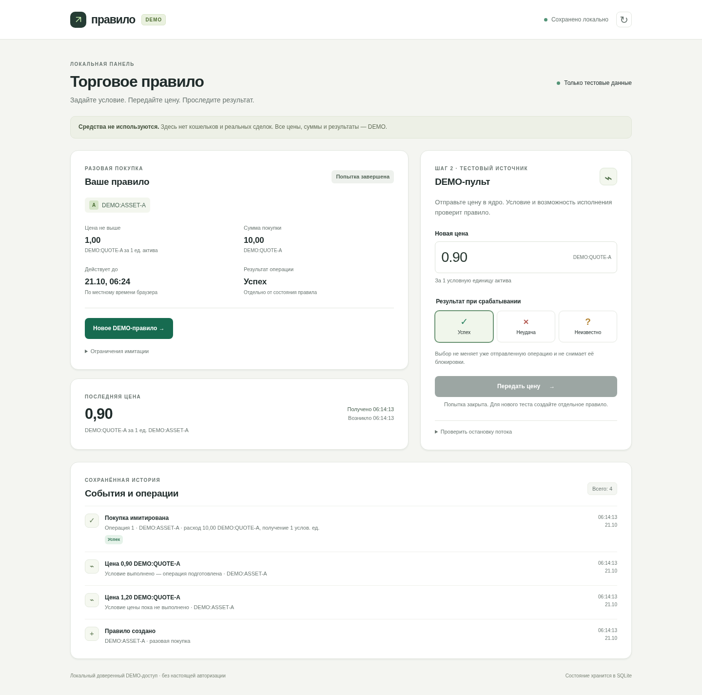
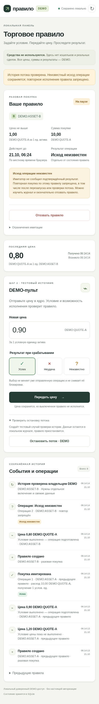

# Передача локального DEMO

Ветка: **`codex/local-demo-panel-handoff`**, база — `origin/main` / `8148f4f226ad5f5eb704a5b3d16fc3d400d98872`. В main ничего не сливается. До этой передачи новые исходники находились только в рабочей Cloud-среде и не были добавлены в Git. Поэтому GitHub main содержал только первоначальный README.

## Что сохранено в ветке

- `prototypes/rule-lifecycle/`: ядро правил/операций, SQLite-хранилище, восстановление, синтетический источник, решения владельца и имитатор.
- `prototypes/rule-lifecycle/web/`: HTTP-слой, HTML/CSS/JavaScript панели и сценарий проверки браузером.
- Все пять наборов тестов, вспомогательные процессы и четыре CLI-демонстрации.
- Бриф, контракты источника/решений, инструкции запуска, сводка проверок, итоговый TAP-отчёт и снимки панели.

Не включены: локальная SQLite-база и её содержимое, секреты/настройки окружения, node_modules, кэш, временные журналы и старые TAP-выводы. Они не удаляются из исходной рабочей среды. Исторические ссылки на такие журналы в брифе обозначают локальные архивные пути, а не файлы этой поставки.

`experiments/swig-pump/` целиком оставлен отдельно в исходной рабочей среде и **не включён в эту ветку**: для запуска ядра и панели он не нужен. Его исходники, старые результаты и бинарные материалы не удалены и не изменены. Эта передача не является резервной копией эксперимента. Исследование подписи и эксперименты безопасности не возобновлялись.

## Доступ из Cloud

Доступный пользователю штатный предпросмотр в этой Cloud-задаче не установлен. Пользовательский интерфейс Cloud сообщает, что localhost snapshots недоступны; среди доступных инструментов нет инструмента публикации предпросмотра. Сервер остаётся на `127.0.0.1`: он не выставляется в интернет, туннель не создаётся. Снимки ниже показывают фактически запущенную панель, но не являются интерактивным приложением.

[Проверки и их границы](prototypes/rule-lifecycle/VALIDATION.md).

### Компьютер



### Узкий экран



<a id="windows"></a>
## Один способ запуска на Windows: WSL 2 / Ubuntu

Нужны Windows с поддержкой WSL 2, интернет и права установки WSL. Этот способ использует Linux-версию Node.js **24.19.0** внутри Windows и сохраняет проверенную среду SQLite/файловой системы. Прямой запуск хранилища в native Windows не проверен и здесь не предлагается: ядро использует синхронизацию каталога на диске. Установка WSL на компьютере пользователя также не проверена в Cloud.

В PowerShell **от администратора**:

```powershell
wsl --install -d Ubuntu
```

После требуемой Windows перезагрузки откройте **Ubuntu** из меню «Пуск», завершите создание локального пользователя. Следующие команды выполняются **в Ubuntu**, не в PowerShell. Менеджер версий берётся из официального репозитория nvm; Node скачивается его установщиком. `npm install` приложению не нужен.

```bash
sudo apt-get update
sudo apt-get install -y git curl ca-certificates
curl -fsSL https://raw.githubusercontent.com/nvm-sh/nvm/v0.40.3/install.sh -o /tmp/demo-nvm-install.sh
bash /tmp/demo-nvm-install.sh
. "$HOME/.nvm/nvm.sh"
nvm install 24.19.0
nvm alias default 24.19.0
cd ~
git clone --branch codex/local-demo-panel-handoff --single-branch https://github.com/iblamekaijse/telegram-mini-app-for-pumpfun.git
cd telegram-mini-app-for-pumpfun
git rev-parse HEAD
node --version
cd prototypes/rule-lifecycle
npm start
```

`node --version` должен показать `v24.19.0`. `git rev-parse HEAD` показывает полученный коммит; сопоставьте его с hash в PR/сообщении о передаче. Сохраняйте проект в домашнем каталоге Ubuntu, как в командах, а не в `/mnt/c` или сетевом каталоге. WSL 2 обычно перенаправляет localhost в Windows; его доступность на конкретном компьютере зависит от настроек WSL/брандмауэра и в Cloud не проверялась. Публичный IP для этого не нужен.

В браузере **этого Windows-компьютера** откройте **http://localhost:4173**. Это не адрес Cloud и не доступ с телефона.

1. Создайте правило с тестовыми значениями: актив A, условие **1.00**, сумма **10.00**, срок **10 минут**.
2. Включите его. В DEMO-пульте выберите «Успех», передайте цену **1.20**, затем **0.90**.
3. Проверьте завершённую попытку и журнал. Обновите страницу.
4. В Ubuntu остановите сервер Ctrl+C, снова выполните `npm start`; обновите страницу. Состояние должно остаться прежним.

При последующих запусках: откройте Ubuntu, выполните `cd ~/telegram-mini-app-for-pumpfun/prototypes/rule-lifecycle` и `npm start`. Не удаляйте `.local-web`: это сохранённая история. Для отдельной проверки набора тестов из того же каталога — `npm test`; тесты используют временные хранилища.

## Границы

Только синтетический DEMO, `LIVE_TRADING_ALLOWED=false`. Тестовый доверенный контекст владельца не является авторизацией. Нет кошельков, реальных сделок и проверки интеграции с Solana. `unknown` остаётся блокировкой, `accept_gap` отключён. Публикация исходников и снимков не означает публичного размещения приложения.
